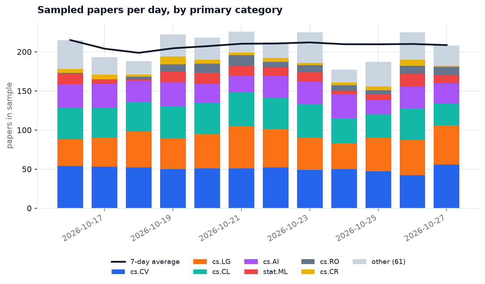
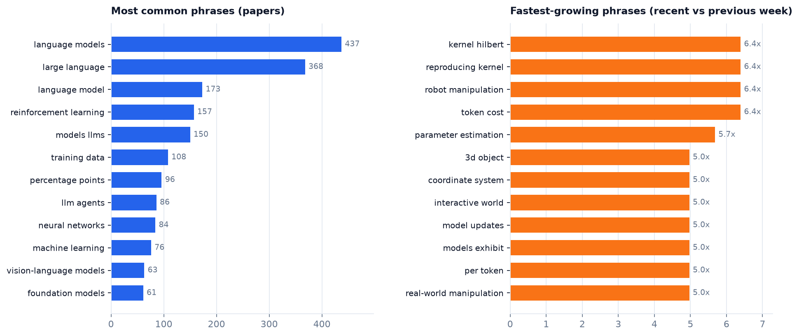
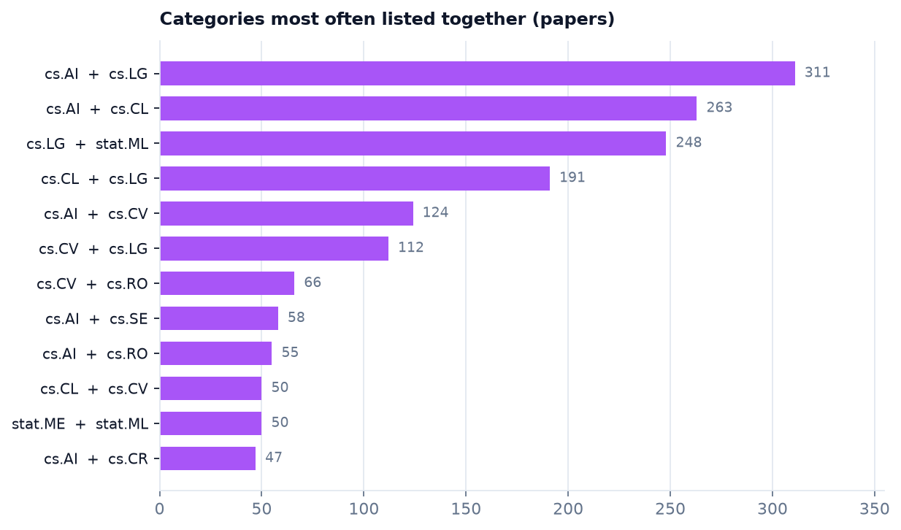
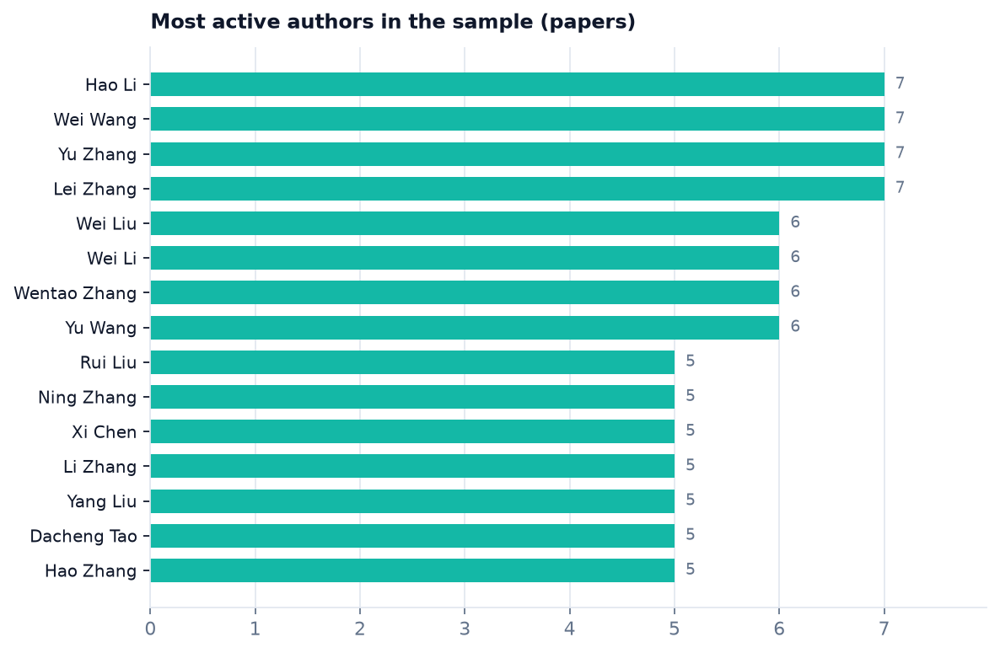

# arxiv-radar

A small lakehouse for arXiv metadata, built on PySpark. It pulls recent ML papers from the arXiv API, lands them as raw JSON, cleans them into partitioned Parquet, and builds analytics tables for volume, topics, authors and cross-listing. A Structured Streaming job replays the same data as a live feed.




## Pipeline

```
arXiv Atom API ──► bronze/  raw JSON lines, one file per run, partitioned by ingest_date
                     │
                     ▼
                  silver/  typed, cleaned, one row per paper (newest version), Parquet by year/month
                     │
                     ▼
                  gold/    daily_volume · category_daily · category_summary
                           top_authors · term_trends · category_links
                     │
                     ├──► docs/img/*.png   (matplotlib)
                     └──► stream/          Structured Streaming replay, 1-day event-time windows
```

| Step | Module | What happens |
|---|---|---|
| Ingest | `radar.ingestion` | One query per category and UTC day, 3 s between calls. Already-seen IDs are kept in a small state file, so reruns only add new papers. If arXiv starts throttling, the papers fetched so far are still written. |
| Silver | `radar.transform.silver` | Explicit schema (no inference scan), whitespace cleanup, timestamp parsing, version de-duplication with a window function, derived columns (`n_authors`, `is_cross_listed`, `abstract_words`). |
| Gold | `radar.transform.gold` | DataFrame API and Spark SQL. Trailing 7-day average with a range window, author counts via `explode`, a category co-occurrence self-join, and keyword trends built from `StopWordsRemover` and `NGram`. |
| Streaming | `radar.streaming` | A file source reads one JSON file per micro-batch, applies a 2-day watermark and counts papers per category in 1-day windows. A feeder thread writes bronze records into the folder in small chunks. |
| Report | `radar.reporting` | Reads the gold tables and renders the PNGs in `docs/img`. |

## What the latest run shows

The run on 30 Oct 2026 covered five categories (cs.LG, cs.CV, cs.CL, cs.AI, stat.ML) over 14 days, capped at the newest 60 papers per category per day. It ingested **2,496 distinct papers** published 16–27 Oct. The last two days were empty because arXiv had not announced them yet.

| Primary category | Papers | Avg. authors | Cross-listed |
|---|---:|---:|---:|
| cs.CV | 607 | 5.68 | 33.4% |
| cs.LG | 515 | 4.18 | 68.4% |
| cs.CL | 453 | 6.53 | 45.7% |
| cs.AI | 325 | 6.29 | 50.2% |
| stat.ML | 124 | 2.97 | 99.2% |

About 61% of papers list more than one category. Querying by category also returns papers whose primary category is somewhere else, so 68 different primary categories appear (cs.RO, cs.CR, cs.SE and others). The most common pairs are cs.AI + cs.LG (311 papers) and cs.AI + cs.CL (263).



"Language models" and "large language" lead the phrase counts by a wide margin. The growth panel compares the last 7 days with the days before, normalized by the number of papers in each window. These counts are small (6–8 papers per phrase), so read it as a list of things to look at, not as evidence of a trend.

<p float="left">
  
  
</p>

The author ranking counts name strings. Common names such as "Wei Wang" probably combine several different people.

## Run it

Requires Python 3.10+ and Java 17+ (for Spark).

```bash
make setup        # venv + editable install
make test         # 20 tests on a local Spark session
make pipeline     # ingest -> silver -> gold -> report  (~4 min, mostly polite API delays)
make stream       # replay bronze through the streaming query, prints each micro-batch
```

Each step can also be run on its own: `radar ingest`, `radar silver`, `radar gold`, `radar report`. Settings live in [`config/pipeline.yaml`](config/pipeline.yaml), and `RADAR_LAKE=/some/path` moves the lake.

## Tests

The tests use a local Spark session and fixtures, so they never call the network:

- parsing a recorded Atom feed, including an error entry and two versions of one paper
- incremental ingest, and the partial save when the API throttles
- silver de-duplication, rejected records, idempotent reruns
- every gold table against a synthetic two-week dataset with known rising, fading and steady phrases
- the streaming query writing to a memory sink

## Limits

- This is a sample. The per-day cap means the chart shows what was fetched, not how many papers arXiv received.
- Keywords come from plain n-gram counts. Embeddings or proper phrase detection would group "language model" and "language models".
- Author names are not disambiguated.

## Layout

```
config/pipeline.yaml    categories, window, Spark and analytics settings
src/radar/
  ingestion/            arXiv client, incremental batch ingest, seen-id state
  transform/            silver cleaning, gold tables, text helpers
  streaming/            file-source query and bronze replay
  reporting/            charts
  cli.py                `radar` command
tests/                  pytest suite and a recorded API response
```
